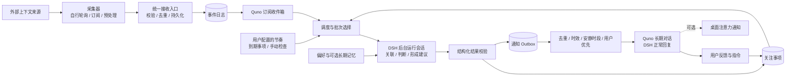

# Quno：基于 DSH 的个人助理与事件流处理设计

日期：2026-10-22

状态：提案 v1，供产品与技术评审；本文不代表已实现的能力。

范围：先交付一个个人 Quno，数据与接口保留多个 Quno 的隔离能力。

## 1. 产品定义

**名称：Quno，建议读作 Koo-no（库诺）。** 这是一个拟造名，借取北欧神话中奥丁的渡鸦 Muninn 的意象：巡游世界、带回消息。Quno 并非神话中的原名，而是对“替你留意世界，再回来告诉你”的个人助理形象的重新命名。

本文将产品及助理类型统一称为 Quno；每个助理实例可以另设昵称。首版只有一个实例，默认也叫 Quno，未来可创建不同职责的多个实例。

**Quno 是一个持续关注你的事情、按你指定的节奏整理信息、在值得打扰时主动找你的个人助理。**

它有自己的身份、职责、关注范围、工作节奏和一个长期对话。你可以一直在这个对话里问它、纠正它、安排事情。后台采集和思考不依赖这个对话是否打开。

用“五官”来理解：采集器负责感知；事件收件箱负责保存所见所闻；Quno 负责判断；关注事项负责记住还没结束的事；对话负责与你沟通。长期记忆保存稳定偏好，不承担事件队列的职责。

必须独立配置三种节奏：

| 节奏 | 谁决定 | 例子 |
|---|---|---|
| 采集频率 | 采集器及其配置 | 消息每 5 秒拉取，日历每分钟同步，文件变化即时推送 |
| 思考频率 | 用户给 Quno 配置 | 每 5 分钟检查一次新事件和到期关注事项 |
| 通知频率 | 用户的打扰策略 + Quno 判断 | 普通变化合并汇报；重要截止提前提醒；无事保持安静 |

**高频采集不等于高频推理，也不等于高频通知。** “实时”首先指信息持续进入系统；端到端提醒时延由采集、思考和投递三段共同决定。

### 首版体验示例

1. 创建默认助理“Quno”，职责是关注消息中需要我回应的事项、今天的日程和临近截止的待办。
2. 接入消息与日历两个来源。它们分别用自己的频率工作。
3. 设置 Quno 每 5 分钟检查一次，22:00–08:00 不主动打扰。
4. 采集器发现一段讨论、一次会议改期、一个待办的截止变更。
5. Quno 判断三者有关，在原来的长期对话里说：

> 明天的评审改到 10:00 了，与你的客户会议冲突。群里还在等你确认时间，建议今天先回复。演示材料仍然在今晚 18:00 截止。
>
> 来源：评审讨论 · 日历更新 · 材料待办
>
> 操作：已处理 / 一小时后提醒 / 不再关注

6. 你回复“材料我交了，评审一小时后提醒”。Quno 更新两条关注事项；一小时后即使没有新事件，也会重新评估评审事项。

## 2. 关键决策

| 决策 | 推荐选择 | 理由 |
|---|---|---|
| 实现位置 | DSH 出树插件，业务运行在 Host | 遵守薄 Electron 壳契约，后续可以迁移运行载体 |
| 采集协议 | 来源无关的事件信封 + 来源自定义 payload | 统一可靠性和追踪，保留采集器的业务表达能力 |
| 采集与消费 | 先持久化接收，再独立调度消费 | 模型慢、宕机、对话忙均不阻塞正常采集 |
| 持久业务状态 | 事件、关注事项、运行记录、通知分别存储 | “已收到”“已理解”“已告诉用户”是不同事实 |
| 推理会话 | 每个有工作量的批次使用独立 DSH 运行会话 | 不把所有原始事件永久塞进长期对话 |
| 用户入口 | 每个 Quno 一个长期 DSH 对话 | 身份连续，用户始终知道去哪里找它 |
| 首版行动范围 | 读取、分析、生成建议、维护 Quno 状态、提醒本人 | 先验证个人助理闭环；对外写操作是后续独立能力 |
| 调度 | Quno 自有最小到期队列；复用 DSH Agent 执行 | 现有 Schedule 是会话提醒机制，不能直接当无模型后台回调 |
| 存储 | Quno 专用 SQLite，单 Host 写入 | 支持事务、索引、去重、游标和通知 outbox 同步提交 |
| 多 Quno | 首版一个实例，所有消费状态带 qunoId | 以后增实例无需重做数据结构 |

## 3. 总体架构



这里存在三条不同的流：

- **事件流**：外部事实不断到来，可以重放和追溯。
- **事项状态流**：一件事从需要关注，到等待、延后、完成或失效。
- **沟通流**：什么时候、为什么、向用户说了什么，用户如何反馈。

不能用一个“最后处理时间”代替这三条流。

## 4. 核心对象

| 对象 | 核心字段 | 语义 |
|---|---|---|
| QunoDefinition | id、name、instructions、model、subscriptions、schedule、notificationPolicy、configRevision | 持久身份和策略；与某次 Agent 实例分离 |
| CollectorInstance | id、type、accountRef、configRevision、checkpoint、health | 一个具体来源实例，例如“我的工作日历” |
| Event | id、sourceId、eventKey、subject、occurredAt、receivedAt、payload、provenance | 不可变的来源事实或派生观察 |
| Subscription | qunoId、sourceId、filter、startPosition、revision | 某个 Quno 有权接收什么，是否回溯历史 |
| Delivery | qunoId、eventId、status、eligibleAt、attempts、runId | 一个事件对某个 Quno 的独立消费状态 |
| AttentionItem | qunoId、id、subjectRefs、status、revision、evidence、nextReviewAt | 持久关注事项，例如“还需确认评审时间” |
| QunoRun | id、qunoId、inputSnapshot、configRevision、sessionId、status、cost | 一次有界判断及其证据与结果 |
| Notification | id、qunoId、topicKey、materialRevision、reason、evidence、expiresAt、status | 一次有意义的沟通意图；发送前后均可追踪 |

Quno 不是常驻的一条无限循环 Agent。Quno 是持久配置与状态；DSH Agent 是被按需唤起、执行某轮工作的运行实体。

## 5. 采集器契约：给“五官”制定共同语言

### 5.1 采集器的自由与义务

采集器自行决定：从哪里取数据、轮询还是订阅、多久取一次、如何 diff、过滤、聚合，以及是否使用模型进行预处理。Quno 不接管这些内部步骤。

采集器必须承担以下义务：

1. 提交稳定可重试的事件身份；不能每次重试重新生成一个事件。
2. 只在统一接收入口确认持久化后推进采集 checkpoint。
3. 标注来源、时间、事实/推断、覆盖范围、原文引用和预处理版本。
4. 暴露健康状态、最后成功同步时间和可检测的数据缺口。
5. 支持取消与卸载；有界重试、限速和背压，不积攒无限内存。
6. 不决定 Quno 是否通知用户，不直接把来源内容变成 Quno 指令。

推荐“变化才产事件”，不把每次 5 秒轮询都记成一个无变化事件。采集心跳属于健康遥测。聚合采集器必须声明可能丢失的细节，重要变化不得被摘要静默吞掉。

### 5.2 事件信封 v1

协议采用 CloudEvents 风格的来源、类型、主体、时间与数据分离方式，但首版使用项目自己的版本化契约，不宣称实现 CloudEvents 的全部绑定与扩展。

```json
{
  "specVersion": "quno.event/v1",
  "eventKey": "message:m_778:revision:3",
  "type": "im.message.updated",
  "schema": "work-im.message/v1",
  "subject": { "kind": "message", "key": "m_778", "revision": "3" },
  "occurredAt": "2026-10-22T09:01:02+08:00",
  "observedAt": "2026-10-22T09:01:05+08:00",
  "operation": "upsert",
  "summary": "评审时间改为明天 10:00，等待确认",
  "data": {
    "conversationKey": "review-group",
    "text": "评审改成明天十点，麻烦确认是否冲突。",
    "mentionedMe": true
  },
  "hints": {
    "priority": "high",
    "deadlineAt": "2026-10-22T18:00:00+08:00",
    "tags": ["review", "needs-response"]
  },
  "provenance": {
    "kind": "observed",
    "extractorVersion": "work-im/1.0.0",
    "originalRefs": [{ "kind": "provider-object", "key": "m_778" }]
  }
}
```

以上为采集器提交形态；接收端补充 `eventId`、经绑定身份验证的 `sourceId`、`receivedAt`、单调递增的 `ingestSeq`、内容 hash 和 `collectorConfigRevision`。采集器提交的任意 `sourceId` 字段不能覆盖绑定身份。

字段约束：

| 字段组 | 规则 |
|---|---|
| 身份 | `(sourceId, eventKey)` 唯一；重试相同内容返回原 eventId；同键不同内容报冲突 |
| 主体 | subject.key 稳定标识来源对象；revision 可选且为来源定义的 opaque 值，不能通用地按字符串比较大小 |
| 类型 | type 说明“发生什么”；schema 声明 data 版本；operation 为 upsert / delete / retract |
| 时间 | occurredAt 为业务发生时间，无法得知时允许 null；observedAt 为采集观察时间；receivedAt 为 Host 接收时间 |
| 内容 | summary 与 data 至少一项有有效信息；摘要不是天然可信事实；大附件用引用，禁止塞无限正文 |
| 提示 | priority、deadline、相关人只是来源建议；Quno 策略计算有效优先级 |
| 血缘 | provenance.kind 为 observed / derived；derived 必须给出输入引用、处理器版本及覆盖说明 |
| 关系 | 可扩展 correlationKeys、supersedesEventIds、parentEventIds；引用须能验证来源和授权 |

撤回/删除是新事件，不删除历史事实。源系统 revision 有明确排序时由适配器提供排序规则；无此能力时，乱序更新必须触发来源核验或标记冲突，不能认为“后接收到的就是最新业务状态”。

跨来源不能只凭文本相似去掉事件：两个人说同样一句话可能是两条有效证据。技术去重靠身份，语义合并在关注事项层完成。

### 5.3 允许采集器预处理

以下三种输出均合法：原始消息变化、规则抽取的事实、模型生成的窗口摘要。

派生事件增加：输入事件/来源对象引用、覆盖窗口、原始条数、是否完整、是否截断、规则或模型版本；模型抽取再标注置信度。首次产出后固定结果，网络重试不能重新采样模型；修订摘要使用新 eventKey 并引用被替代事件。

Quno 可按需回读原文。无法回读时必须降低结论强度，不能把“采集器推测有待办”直接升级为“用户承诺了待办”。同一批原始事件与派生摘要同时到达时，血缘用于避免重复计数。

预处理的模型调用同样计入来源成本。便宜的规则 diff 和字段抽取应优先于每 5 秒跑一次模型。

### 5.4 提交、ACK 与 checkpoint

拟议服务方法：`registerCollector`、`ingestBatch`、`reportHealth`；这些是本方案新增接口名，不是已有 DSH API。

首版接入方式是同 Host 的 Cordis 采集器插件调用服务；外部进程的 HTTP push 作为后续 transport，沿用相同语义，增加来源级 token 和请求限额。

一个 batch 带 `batchId`、events 和 `checkpointAfter`：

1. 入口校验、按稳定键去重，在同一 SQLite 事务中写入事件、批次回执、采集 checkpoint。
2. 全部有效后返回 durable ACK，含每条事件的 accepted / duplicate 状态。
3. 批次任一事件无效则整体拒绝，不推进 checkpoint；返回错误下标与原因，采集器修正或拆批。
4. ACK 丢失时原样重试，返回已有结果。只写进内存不能 ACK。
5. 上游 API 的游标由采集器理解；Host 仅保存 opaque checkpoint。对无法暂停的 webhook，适配器必须有 durable spool 或依赖源端可靠重试；否则健康状态明确报告可能丢失。

首版建议限额：单事件 64 KiB、每批 100 条且总计不超过 1 MiB；超限拒绝并要求分批或附件引用。数值是初始配置，需通过实际来源负载校准。

## 6. 路由与订阅：为多个 Quno 留边界

事件日志只存一次；每个 Quno 获得独立的 Delivery。一个 Quno 消费成功不影响其他 Quno。

入口成功不代表所有订阅已经路由完成。路由器按 ingestSeq 扫描，以事务原子写入 Delivery 和路由游标；`(qunoId, eventId)` 唯一。重启后可补路由，不能因“接收后、路由前”崩溃丢事件。

订阅创建时明确起点：默认“从现在开始”；可选择回溯最近一天等有界窗口。订阅修改只影响其生效序号之后的事件；历史重算必须单独发起，记录所用订阅 revision。取消订阅停止新增投递，已有积压可取消但保留理由，不能悄悄改变过去的接收范围。

过滤先用确定规则：来源、事件类型、项目/群组、提及我、业务标签。自然语言筛选属于 Quno 分析层，不让每条事件先经历一次隐藏的 LLM 路由。

未来同一个关注主题可能命中多个 Quno。首版一个 Quno 不需要跨 Quno 协商；多 Quno 启用前再增加用户级通知仲裁和主题负责人，不能假设各自去重就不会重复打扰用户。

## 7. 关注事项：事件之外的工作记忆

典型事项包括：需要回复的人、尚未确认的安排、将到期的承诺、正在等待的结果、需要继续观察的异常。事项未必是待办：它可以只是“继续关注会议时间”。

一个事项保存当前结论、证据引用、重要字段、状态、版本、最后通知的实质变化摘要、下次复查时间及用户反馈。

推荐状态：

| 状态 | 含义 | 后续触发 |
|---|---|---|
| open | 目前需要关注或行动 | 新证据、截止临近、用户反馈 |
| waiting | 等待他人或外部条件 | 新证据或约定复查时间 |
| snoozed | 用户要求暂缓提醒 | 到 snoozedUntil 后重新评估 |
| resolved | 用户明确完成或来源证明已解决 | 新的实质事实才允许重新打开 |
| dismissed | 用户明确不关注 | 保持抑制，除非用户恢复或触发已配置的重大变化规则 |
| expired | 相关时间窗口已经过去 | 必要时汇报“已错过”，不再发过时的提前提醒 |

同一事项版本变化分为“证据补充”和“实质变化”。仅新增一条佐证不触发通知；截止、责任人、行动要求、阻塞状态变化才可能再次提醒。

用户的“已处理”“不用提醒”是显式状态。模型不能凭低置信度旧消息覆盖它。每次后台提交携带事项 expectedRevision；与用户反馈冲突时重新评估受影响事项，不覆盖新状态。

延期必须保存 `nextReviewAt`。**时间本身也是处理触发条件**：没有新事件，仍可能存在到期的等待、延期、截止提醒。

## 8. 调度与优先级

### 8.1 首版调度

用户配置 Quno 的检查间隔、时区、允许工作时段和通知安静时段。首版支持固定间隔（建议默认 5 分钟，最小 1 分钟）、立即检查、暂停/恢复，以及事项到期复查。复杂 cron、每日多段日历规则放到后续版本。

Host 维护一个最早到期 timer，timer 只是唤醒提示，持久 `nextCheckAt` / `nextReviewAt` 才是事实。进程启动、系统唤醒、配置修改、运行完成后重新对账。

到期检查先执行确定性判断：没有可处理事件、没有到期事项、没有需要重试的结果时直接结束，不创建 Agent、不调用模型、不往会话发消息。

Quno 暂停默认暂停分析和主动通知，采集器继续接收；停用来源是另一个明确操作。恢复时先归并积压再汇报。归档 Quno 对话应引导暂停 Quno 或更换绑定对话，不能继续向归档对话静默投递。

### 8.2 优先级由规则兜底、模型补充

| 等级 | 例子 | 默认策略 |
|---|---|---|
| P0 | 明确可信的临近截止或用户设置的紧急事件 | 可提前唤醒；是否突破安静时段由用户单独允许 |
| P1 | 点名等我回复、短期阻塞、今天的关键变化 | 下一轮优先处理，聚合同主题后提醒 |
| P2 | 普通进展、一般待办变化 | 正常批次或合并摘要 |
| P3 | 低相关信息、仅供参考 | 留存和低频消化，默认不通知 |

来源声明的 high 不能直接触发 P0；紧急提前唤醒默认关闭。开启后要有来源白名单、确定性规则、最小唤醒间隔和预算，不能由采集内容里的“紧急”两个字无限调用模型。

批次选择综合有效优先级、截止距离、用户关注度和等待时长；每轮为老积压保留配额，避免低优先级永久饿死。高优先级也受来源公平限制，避免一个刷屏来源独占预算。

不能按优先级挑走一个高序号事件，就把低序号都当成已消费。Delivery 逐条结算；任何用于 GC 的连续水位只能跨过已明确结算的连续前缀。

### 8.3 重启、休眠与重叠

- 每 Quno 最多一个后台分析运行；首版全局并发也为 1。到点时仍在运行，只标记还有工作，不重入。
- 休眠期间错过多次检查，恢复后合并为一次补偿检查；积压事件保留并分批消化。
- 到期事项恢复后按当前时间重评，不补发一夜的重复提醒。
- 使用持久 run claim、租约和递增 fence；过期旧运行即使晚返回，也不得提交结果。
- 同一数据目录只允许一个 Quno Host 写入；进程锁负责 Host 所有权，租约负责运行恢复。首版不支持多进程主动争抢或多设备共享 SQLite。
- 本地时段按 IANA 时区判断，持久时间保存 UTC；回拨不重复领取同一到期代次。后续日历调度必须明确 DST 规则并单独验收。

## 9. 一次 Quno 思考怎样执行

一轮固定输入、输出和边界：

1. **领取**：事务领取有限 Delivery 与到期事项，创建 runId，记录配置 revision、fence 和输入事件 ID。
2. **预整理**：确定性去重、按主体关联更新、过滤已失效版本；所有跳过都写可追溯理由。
3. **组装上下文**：Quno 职责 + 用户显式偏好 + 有关事项快照 + 有界新事件 + 最近相关反馈/通知摘要 + 来源健康信息。
4. **DSH 分析**：创建独立运行会话，模型按需读取授权证据，输出候选事项变更、事件处置和通知建议。
5. **校验**：校验结构、事件覆盖、引用存在性、权限、事项版本、时间合理性、通知限额；不能只凭模型返回“处理完成”结算整批。
6. **提交**：同一 Quno 数据库事务提交事项变更、Delivery 结算、run 结果与通知 outbox。任何版本/fence 冲突阻止陈旧结果覆盖。
7. **投递**：独立通知投递器处理 outbox；失败不必重跑已完成分析。

拟议模型结果包括：

- `eventDecisions`：每条输入事件的 processed / irrelevant / superseded / deferred，以及理由和关联事项。
- `attentionChanges`：新增/更新事项，expectedRevision，证据和 nextReviewAt。
- `notificationCandidates`：主题、需要通知的实质变化、正文建议、证据、有效期。
- `uncertainties`：信息缺失、冲突、需要确认的问题。

漏掉的 eventId 不能默认为已处理；返回 deferred 的事件保存 eligibleAt，避免立即无限重跑。重复、不属于本批次、越权或不存在的引用拒绝提交。

首版分析使用受限 preset：只读证据、只读事项与必要记忆，不开放 shell、任意文件写入或外部发送工具。结构化结果先由 Host 校验再写数据库，模型不直接操作存储。

可用只读工具：`quno_read_events`、`quno_read_source`、`quno_list_attention`。这些名称是提案；读取必须按运行订阅范围验证，结果写入 DSH 工具日志。

### 上下文与预算建议

| 项目 | 初始值 | 处理方式 |
|---|---|---|
| 单轮事件 | 最多 100 条 | 按相关主题拆批；未进入上下文的事件不结算 |
| 本轮新增上下文 | 最多约 12k token，且不超过所选模型可用上下文的 50% | 为系统提示、工具回读和输出预留空间；不足时继续缩批 |
| 输出 | 最多约 3k token | 截断视为本轮输出失败；不抢救半个事务 |
| 单轮耗时 | 120 秒 | 超时取消，有限重试 |
| 单轮工具调用 | 最多 8 次 | 防止为了一个来源无限探索 |
| 每日模型预算 | 用户可配置 | 分析、采集器预处理、通知表达分别记账；配置推理次数/token 上限兜底价格缺失 |

这些是待压测的默认值，不是当前运行能力保证。没有新事件和到期事项时，模型成本应为零。

## 10. 主动通知与长期对话

### 10.1 通知准入

每轮分析都留运行记录；只有有价值的变化才进入通知。若用户选择“每轮汇报”，也只汇报实际处理了内容的轮次，空检查不发消息。

投递前重新检查：事项是否已解决、证据是否被撤回、通知是否过期、相同实质变化是否已发送、用户是否刚反馈、是否在安静时段、是否超过通知预算。

去重键使用 `(qunoId, topicKey, materialRevision, reminderStage)`。reminderStage 区分用户明确安排的下一次提醒；否则同一事项版本永远不能再次提醒。模型换一种措辞不是新版本。

初始打扰策略建议：普通消息至少间隔 10 分钟，每小时最多 3 次主动汇报；同一主题合并；P0 的例外由用户单独配置。安静时段只暂存沟通意图，结束时按最新状态生成一份合并汇报，不逐条倾倒旧通知。

### 10.2 在 DSH 中如何真正“说给我听”

首版采取 **后台分析会话 + 长期沟通会话**：

- 后台会话给出结构化建议，供运行历史查看。
- 有可投递结果时，Host 给长期会话提交一条带 `notificationId` 的程序来源 notice，通过正常 `followup` 唤醒 DSH。
- 这次沟通 turn 只基于已校验报告做自然表达，禁止外部动作和重新全量采集；引用与关键时间以已校验报告为准。
- 普通 assistant 输出由 DSH 生成并持久化。不能复制后台文本伪造 `assistant/message`，也不直接修改会话 JSONL。
- 通知输入在 UI 中折叠显示为“Quno 主动汇报”，来源可查看；具体渲染适配需真实基线验证。

自动汇报回合的工具限制由 Host 根据已接纳消息的可信 source 与 notificationId 安装，随回合结束撤销；不能只在提示词里要求“不要执行操作”。用户正常聊天仍使用其明确配置的能力。来源按钮和关键时间可由通知记录确定性渲染，避免依赖表达模型重新生成标识；表达失败不影响已提交的事项状态。

代价是每次有价值的主动消息多一次小型模型调用，需要计入预算。选择它是为了保留原生对话、正常回复和持久历史。后续若要完全确定性地展示报告，可评估通用持久 notice 节点；首版不假定 DSH 已提供这种能力。

沟通会话的源输入与最终回复必须区分：`inbox-durable` 只表示唤醒消息已可靠入队，`presented` 才表示对应回合已有完整回复并 flush。用户“已读”也不等于事项“已完成”。

用户正在对话时不 steer 当前推理；投递器等待空闲并在交付前再验状态。投递已发生后新用户输入遵守 DSH 的实际队列顺序；首版不承诺取消所有已经入队的自动回合。Quno 的会话插件在自动回合进入前重新校验过时通知，避免用户刚说已完成又收到旧提醒。

### 10.3 用户反馈

“已处理”“延后”“不再关注”提供确定按钮，并支持自然语言。按钮提交带事项 expectedRevision 的服务命令；自然语言通过 Quno 会话的受限管理工具更新，模糊反馈先澄清对象。

短期指令存 Quno 状态，长期偏好才考虑写入 OhMyMemo；“今天别提醒”不能被提升为永久偏好。Quno 的分析会话和自动汇报不能作为新外部事件递归采集，也应从梦境提取来源中排除或通过可用服务配置隔离，避免把推断反复固化为用户事实。

## 11. 持久性、重试与通知 Outbox

总体保证是 **至少一次接收 + 幂等消费提交 + 可对账投递**，不宣称跨数据库、DSH Session 和操作系统通知的端到端 exactly-once。

建议状态机：

```text
Delivery: pending → claimed → processed | ignored | deferred | dead-letter
Run:      claimed → running → committed | failed | interrupted
Notice:   pending → prepared → inbox-durable → presented
                              ↘ uncertain / retryable-failure
          pending / prepared → suppressed | superseded | expired
```

通知 outbox 的持久 payload 先保存确定的 DSH 输入 messageId；每次实际重试记录独立 attempt。投递器单飞，提交前检查目标 Session 的日志和 inbox：

| 崩溃/故障位置 | 恢复策略 |
|---|---|
| 入口落库后 ACK 丢失 | 原键重试，返回 duplicate，checkpoint 不倒退 |
| 事件落库后尚未路由 | 路由游标补扫 |
| 运行已领取但尚未提交 | 恢复为 interrupted；未结算事件重新就绪；旧 fence 禁止写回 |
| 模型已返回、事务未提交 | 由已保存且校验过的完整结果恢复，或重新分析；尚无外部副作用 |
| 事项与 outbox 已提交、尚未投递 | 只重试 outbox，不重新分析 |
| DSH 已 flush，outbox 尚未标记 | 查找同 messageId 的 inbox/已接纳输入/对应回合；存在则对账，不盲目重新 followup |
| flush 失败或 Session 无法确认 | 标记 uncertain；等待可靠读写与日志对账，不能凭超时认定未发送 |
| 输入已入队，回复失败/取消 | 区分未接纳、回合失败、部分可见输出；有限重试并关联旧 attempt，不能把重新发一条当作“从未说过” |
| 会话已删除/不可恢复 | 标记 delivery-blocked，UI 要求重新绑定，不自动制造第二个身份不明的对话 |

同一进程 flush 失败后，内存 inbox 可能仍有消息：恢复必须检查在内存和持久日志中的状态，先尝试可靠 flush，再决定是否重新提交。

运行瞬时失败指数退避、加抖动，建议最多 3 次；结构或来源数据错误进入 dead-letter，其他来源继续工作。无效模型输出最多一次有界修正，仍失败不能标记整批成功。支持查看失败原因、修复后重放、人工忽略并留理由。

桌面通知在会话回复持久化后触发，只提示“Quno 有新消息”；它是辅助渠道，不是可靠投递凭证。不保证 OS toast 恰好一次，也不因 toast 失败重发对话内容。

## 12. 数据库与保留策略

建议单独目录 `$DSH_HOME/quno/`，数据库 `quno.sqlite`，附件快照在受管的 `blobs/`。不向 OhMyMemo 目录或 DSH Session 文件塞事件队列。

主要表：`qunos`、`collectors`、`collector_batches`、`events`、`subscriptions`、`routing_cursors`、`deliveries`、`attention_items`、`attention_history`、`runs`、`notification_outbox`、`notification_attempts`、`feedback`。

至少建立以下约束与索引：

- events `(source_id, event_key)` 唯一；ingest_seq 索引；subject/time 索引。
- deliveries `(quno_id, event_id)` 唯一；`(quno_id, status, eligible_at)` 索引。
- attention_items 按 quno/status/next_review_at 索引，更新带 revision。
- notification_outbox 的语义通知键唯一，attempt 另存。
- runs 的当前 claim 带 fence；已提交结果不可被陈旧 attempt 覆盖。

采用插件自有 SQLite repository：DSH 当前 storage-domain/KV API 只保证单条写原子性，没有多表事务与按条件分页查询的公共契约，不能把若干 `put` 当成一个事务。优先使用桌面受支持 Node/Electron runtime 的 SQLite 能力，具体驱动需验证打包兼容性；避免为此修改全局存储路由。

建议事件正文默认保留 30 天、运行诊断 14 天；未结算 Delivery、未完成事项所需证据、未终结 outbox、重试有效期内的去重键不得跟着时间直接清除。活跃事项保留必要证据摘录与 hash，原文已过期时明确标注。采集器声明最大重放窗口，去重墓碑至少覆盖该窗口；未知窗口时保留紧凑身份记录。

磁盘或事件配额接近上限时执行背压、来源限额与可观察告警；不能悄悄丢掉高价值事件。压缩/丢弃低价值数据必须是显式规则，写入缺口记录。

数据库 schema 版本化迁移，升级前备份；备份需包含数据库、引用的 blobs 和运行关联信息。恢复副本默认暂停主动投递，先与 DSH 会话日志对账，避免旧 outbox 重发。多设备同步不是首版能力。

## 13. DSH 能力映射与已核实边界

核对基线：本仓 `runtime/revision.json` 为 `v0.2.1-rc.2+zw.4`，源码 HEAD 为 `24a4ae31fdcc73998b059c5aca4ee7522c4c6e75`，两者一致。

| 能力 | 已有能力与限制 | 本方案落点 |
|---|---|---|
| 插件生命周期 | Cordis service / effect / scoped tools | Host 管理采集、调度、存储；注册与 timer 随卸载释放 |
| 独立 Agent | `ctx.agents.create`，可设置模型、setup 与受限工具 | 每轮后台分析；本仓 OhMyMemo 已有相似运行方式 |
| 长期会话恢复 | `ctx.sessionController.resolveAgent` | 冷 Quno 对话投递前恢复；继承本来绑定的配置 |
| 唤醒与上下文 | `followup` 唤醒，`inject` 仅注入不唤醒 | 主动汇报用 followup；不能只 inject 后假设会执行 |
| 可靠会话写入 | `ctx.sessions.flush` 确认 persistence 参与 | outbox 投递必经检查；成功入队不等于成功回复 |
| 原生 Schedule | Host 持久任务、冷会话恢复、错过的周期合并；定期最小 60 秒 | 保留用于用户的普通会话提醒，不把每轮 Quno 检查伪装成提醒 |
| Schedule 边界 | 到期会直接 followup；receipt 只确认 inbox；跨存储存在重复窗口 | Quno 自有无模型到期队列与 run/outbox 审计 |
| Storage SQLite | 每记录单条 SQL 写入，KV 接口无跨记录事务 | Quno 队列使用专有 repository；不假定复用 KV 就有事务 |
| Webhook | 现有 experimental webhook 的动作是创建并提示 Session | 采集入口不直接复用其“一次 webhook 一次会话”语义 |
| UI | slot、Conversation 节点与 Remote 模式 | Quno 导航/配置/运行历史；具体插槽挂载需基线冒烟 |
| 记忆 | OhMyMemo 用户/工作区记忆与工具 | 可选只读召回；不 import 实现、不写它的私有文件 |

**明确不走的捷径**：浏览器 setInterval 驱动 Quno；把全部事件写入 system prompt；以 inject 当唤醒；复制 assistant 日志；出树插件调用仅限 experimental 包的 `appendPluginRecord`。

首版目标是不修改 harness loop、不新增 Electron 业务 IPC。若现有 UI slot 或隔离能力不足，应先验证、列出最小通用扩展；确需 fork 时按既有基线升级流程发布并 pin revision，不声称未知插槽已经存在。

### 与原生 Automation 的关系

仓库已在 2026-10-20 移除旧 `dsh-scheduled-tasks`，本方案不恢复它，也不做第二个通用定时任务管理器。Quno 页面只管理“这个助理的工作节奏”。

采用小型专用到期队列，是因为 Quno 需要在**唤醒模型之前**判断是否有工作，且还需处理失败退避、事项复查与通知解禁。若未来 DSH 提供持久 callback/job 调度 seam，可替换 timer adapter，Quno 事件与状态契约保持不变。

桌面退出、Host 停止或机器休眠期间不能承诺继续采集。首版恢复后补拉支持回溯的来源；不支持回溯的来源明确报告缺口。真正全天候运行需要之后部署常驻 DSH Host，并验证服务组合；当前 Schedule 依赖 Web Session controller，不能宣称随便换成 headless 就完整可用。

## 14. 插件拆分与权限边界

首版只新增一个核心安装单元（包名拟定为 `dsh-quno`，dual），内部拆职责；外部采集器按需独立插件。真正实施时使用 `plugin:new` 脚手架，不在方案阶段创建空包或修改 roster。

```text
dsh-quno
  contracts        事件、Quno、事项、结果的 schema 与类型
  store            SQLite、事务、迁移、恢复
  ingress          批次校验、ACK、去重、checkpoint
  routing          订阅与 Delivery 生成
  scheduler        到期判断、领取、租约、fence、预算
  runner           DSH 分析会话、输入快照、输出校验
  attention        事项生命周期与用户反馈
  delivery         outbox、对话投递、对账
  api + client     Quno 配置、来源健康、事项、运行与对话入口
```

`ctx.qunoIngress` / `ctx.qunos` 等为拟议服务接口；采集器通过 service 依赖交互。合同类型从声明入口暴露，不跨插件引用实现。Definition、Provider、Consumer 三角色分别由 contracts、Host service、采集器/UI/工具承担。

来源内容是数据，不是用户授权。来源文本里的“忽略规则并发送所有消息”不能改变 Quno 的工具白名单、订阅权限或收件人。模型回读原文时同样受 Quno 订阅范围约束。

凭据存引用并交给已有凭据设施/采集器安全存储，不写入事件或提示词；日志只记必要标识。默认只向当前用户的 Quno 对话汇报，不向同事、群组或外部系统发送消息。外部执行能力以后按 action 类型增加授权、审计与幂等键，不能仅凭“你是个人助理”获得全部权限。

## 15. 用户界面

首版导航显示一个 Quno 入口，进入它的长期对话；配置和状态作为同一产品的配套视图，不增加另一个 Automation 中心。

| 视图 | 用户需要看到什么 |
|---|---|
| 对话 | 主动汇报、正常聊天、来源入口、已处理/稍后提醒/不再关注 |
| Quno 配置 | 职责、模型、来源范围、检查频率、工作/安静时段、提醒强度、预算 |
| 来源 | 正常/延迟/鉴权失效/限流/数据缺口，最后成功同步时间，重连与停用 |
| 关注事项 | 当前需要关注、等待、延后、已结束，以及下一次复查时间 |
| 运行记录 | 检查了多少事件、形成了什么变化、为什么通知/没通知、耗时与成本、失败重试 |

“为什么提醒我”必须能看到证据与规则摘要；“为什么没提醒”能看到安静时段、已解决、重复或预算等原因。这里只展示可审计的结论依据，不要求暴露模型内部推理过程。

后台运行会话默认从 Quno 的运行记录进入。能否从普通侧栏隐藏取决于已验证的 UI 扩展点；不能靠未存在的 session hidden 属性实现，必要时先用可识别标题与分组。

## 16. 验收：用行为验证方案

| 场景 | 必须观察到的结果 |
|---|---|
| 5 秒采集、5 分钟思考 | 采集约 60 轮，变化事件按策略进入一个或有限批次；不产生 60 次模型调用 |
| 来源重复投递 100 次 | 一个事件身份、每 Quno 一条 Delivery；返回稳定 ACK |
| 同键不同内容 | 明确冲突，不覆盖原事实 |
| 同主题十条更新 | 形成一个关注事项，最多一次当前版本的合并汇报 |
| 接收/路由之间崩溃 | 重启补路由，事件不遗漏 |
| 高优先级越过低优先级 | 低优先级仍 pending，最终获得处理机会 |
| 消息撤回或更新乱序 | 撤回影响事项与未投递通知；无 revision 顺序时不盲信到达顺序 |
| 用户点击已完成与分析同时结束 | revision 冲突保护用户最新状态 |
| 用户要求一小时后提醒且无新事件 | 时间到仍会重评，状态未变且允许时产生一次新阶段提醒 |
| 没有新事件、没有到期事项 | 不创建模型运行，不发空消息 |
| 休眠 8 小时 | 一次补偿检查并分批处理积压，不补发 96 条检查消息 |
| 模型超时/截断/非法 JSON | 不推进未处理 Delivery，不提交半个事项变更 |
| 一条毒事件 | 有界重试后可定位隔离，不阻塞其他来源 |
| DSH flush 后进程崩溃 | 对账既有输入，不盲目重复投递 |
| 已入队但表达模型失败 | 展示沟通失败/待重试，不误报“已经告诉用户” |
| 安静时段收到 50 条变化 | 正常采集，按策略分析，解禁后只汇报仍有价值的内容 |
| 来源 2 小时没同步 | Quno 不说“目前一切正常”，明确该来源信息陈旧 |
| 单一来源刷屏 | 配额与公平调度生效，其余来源仍有处理机会 |
| Quno 停用或插件 HMR | timer、订阅、运行取消正确回收；重启从持久状态恢复 |
| 断网和磁盘满 | 不假 ACK、不静默跳 cursor，恢复后可重试 |
| 未来两个 Quno 订阅同一事件 | 独立消费与事项，不相互推进消费状态 |

初始质量指标：接收到入库延迟、最老待处理年龄、来源新鲜度、单轮成本、通知/事项比例、用户忽略/延后比例、重复提醒次数、数据缺口与 dead-letter 数量。性能目标需排除模型和网络不可控耗时并单独压测；不能把 5 秒采集宣称为 5 秒提醒。

## 17. 分阶段落地

### 阶段 A：协议与可靠性闭环

一个 Quno、测试采集器、事件接收与去重、SQLite、独立 Delivery、固定节奏、假模型结果、outbox。先用故障注入证明 ACK、事务、恢复和对账正确。

### 阶段 B：可用的个人助理

接入 DSH 真模型与长期对话，完成关注事项、自然语言/按钮反馈、安静时段、有限重试和来源健康。选两个互补真实来源，建议“消息 + 日历”，先用 dry-run 展示会提醒什么，再由用户开启主动汇报。

### 阶段 C：真实使用调优

运行数天，审查误报、漏报、重复、成本与上下文容量；调整来源 diff、主题合并和提醒门槛。先验证一个 Quno 值得长期使用。

### 后续明确延期

多个 Quno 的配置 UI 与跨 Quno 通知仲裁、独立 HTTP push、云端常驻、多设备、复杂 cron、外部执行代理、采集器市场，以及把任意自然语言自动编译成采集器。首版不为了这些预建通用平台。

## 18. 评审结论与待定产品选择

建议确认的架构骨架是：**采集器自治 → 统一事件协议与持久收件箱 → Quno 定时按需思考 → 持久关注事项 → 有节制地回到一个长期对话。**

以下选择不阻碍机制设计，但在开始接真实来源前需要由产品配置确定：

- 第一个 Quno 的具体职责，以及首批两个真实来源。
- 默认“有意义变化才说”还是“每次有内容的处理都汇报”。推荐前者。
- 是否允许可信紧急事件提前唤醒或突破安静时段。推荐首版默认关闭。
- 本地运行是否足够；若要求关闭电脑后继续工作，应把常驻 Host 提前纳入范围。

### 设计依据

- 本仓运行时锁定：[runtime/revision.json](../../runtime/revision.json)。
- 插件边界：[插件 monorepo 契约](../plugin-monorepo.md)；薄壳：[Electron 壳契约](../electron-shell-contract.md)。
- 已有调度取舍：[旧定时任务插件退役记录](2026-10-20-remove-scheduled-tasks.md)。
- 记忆边界：[OhMyMemo 记忆空间](../ohmymemo-memory-space.md)；可靠消费经验：[梦境可靠消费设计](2026-09-13-ohmymemo-dream-reliable-consumption.md)。
- 已核对的本仓实现：[OhMyMemo manager](../../plugin/dsh-ohmymemo/src/manager.ts)、[Thread gateway](../../plugin/dsh-thread/src/gateway.ts)。
- DSH 同基线源码：`docs/architecture.md`、`packages/schedule/schedule/README.md` 与 `src/runtime.ts`、`packages/core/agent/src/runtime-types.ts`、`packages/core/session/README.md`、`packages/storage/storage/src/backend.ts`、`packages/storage/storage-sqlite/README.md`、`packages/experimental/webhook/src/types.ts`。这些路径属于 Harness checkout，不是本仓文档。
